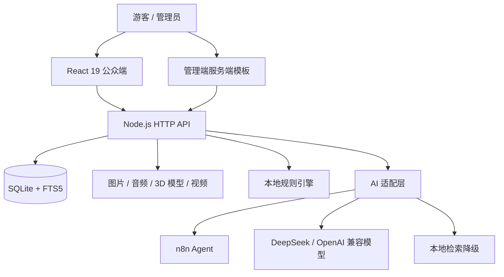

# 遗脉 · 非遗数字展馆

面向公众与非遗管理机构的非物质文化遗产数字化平台。项目以“建档、审核、发布、探索、导览”为主线，将档案管理、公众展示、AI 问答、三维器物和关系探索整合为一个可运行、可降级、可扩展的 Web 应用。

---

## 一、项目简介与亮点

传统非遗资料往往分散在名录、申报材料、图片、音视频和传承人口述记录中。普通门户通常只能提供关键词检索，难以呈现项目、人物和地区之间的关联，也难以证明 AI 回答来自真实档案。

“遗脉”围绕三个目标建设：

1. **资源统一治理**：统一管理非遗项目、传承人、保护单位、多媒体附件和知识条目。
2. **审核业务闭环**：通过草稿、待审核、已发布、已退回和已归档状态控制公开内容。
3. **文化传播与探索**：通过 AI 导览、三维器物、地域星图和人物关系降低非遗理解门槛。

### 核心亮点

- **AI 有据可查**：优先检索站内已发布档案，回答展示来源，外部服务异常时自动降级。
- **三维器物叙事**：使用 model-viewer 展示本地 GLB 模型，并结合器物档案与主题章节进行科普。
- **关系探索**：地域星图、项目星群、人物星群呈现项目、传承人与地区之间的关系。
- **完整业务闭环**：建档、提交、审核、发布、公众展示和审计在同一平台内完成。
- **后端低依赖**：服务端基于 Node.js 内置模块，部署轻量；管理端、导入导出和图表均保持低依赖实现。
- **可回退的智能能力**：n8n Agent、DeepSeek 和本地检索逐级降级，外部 AI 不可用时仍保留站内结果。

### 推荐演示路线

```text
首页视频 → 逛非遗筛选 → 项目详情 → 三维器物馆
→ 非遗探索星图 → AI 小遗 → 管理端审核流程
```

---

## 二、参赛与团队信息

| 项目 | 内容 |
| --- | --- |
| 项目名称 | 遗脉 · 非遗数字展馆 |
| 团队名称 | 爱拼才会赢 |
| 主要开发 | 王丽莹、代晶晶 |
| 技术栈 | React 19、TypeScript、Node.js、SQLite、DeepSeek、n8n、model-viewer |
| 代码仓库 | <https://github.com/Wlymc/ICH-Management-Platform> |

---

## 三、功能概览

### 1. 公众端

| 页面 | 地址 | 主要能力 |
| --- | --- | --- |
| 首页 | `/` | 非遗视频背景、项目检索、AI 小遗、门类入口、精选项目、传承人故事 |
| 逛非遗 | `/projects` | 按类别、级别、地区、年份、是否含 3D 模型筛选 |
| 项目详情 | `/projects/:id` | 历史渊源、技艺特征、传承谱系、传承人、图片音频、3D 模型、数字讲解 |
| 传承人 | `/inheritors` | 人物列表、从艺经历、技艺特点、代表项目 |
| 非遗探索 | `/explore` | 地域星图、项目星群、人物星群、关系搜索与故事化跳转 |
| 三维器物 | `/models` | 8 个项目、15 个模型、四章主题导览、模型切换 |
| 探访线索 | `/organizations` | 已发布且核实开放信息的传承基地与保护单位 |
| AI 小遗 | 全站悬浮入口 | 站内检索、来源展示、推荐入口、语音输入与朗读 |

公众端只展示已发布内容。项目详情支持直接链接刷新，并由服务端注入标题、描述、Open Graph 和 canonical。

### 2. 管理端

| 模块 | 主要能力 |
| --- | --- |
| 工作台 | 指标卡、待办事项、最近录入、分类统计、操作动态 |
| 档案管理 | 项目、传承人、传承基地的新增、编辑、查看、删除和关联 |
| 审核中心 | 提交、通过、退回、审核意见和批量操作 |
| 多媒体档案 | 图片、音频、PDF、Word 附件；视频外链 |
| 数据字典 | 类别、级别、行政区、批次、基地类型 |
| 用户管理 | 角色、启停、重置密码 |
| 操作日志 | 登录、增删改、审核、导入导出和配置变更 |
| 数据大屏 | 手写 SVG 图表、分类与地区统计、全屏展示 |
| 数据交换 | CSV/XLSX 导入导出、逐行错误反馈 |

### 3. 审核流转

```text
草稿 ──提交──▶ 待审核 ──管理员通过──▶ 已发布 ──▶ 门户 / 大屏
                   └──管理员退回──▶ 已退回 ──修改后重新提交──▶ 待审核
```

- 录入员可以维护自己负责的档案并提交审核。
- 录入员不能发布、审核或修改他人数据。
- 未发布内容不会出现在公众端、SEO 和公开 API 中。
- 关键操作写入审计日志。

### 4. AI 小遗

| 能力 | 说明 | 是否消耗模型 |
| --- | --- | --- |
| 指令型查询 | 本地规则解析类别、级别、地区、批次和年限 | 否 |
| 站内问答 | 检索已发布档案后生成回答并展示来源 | 是 |
| 内容起草 | 离线生成草稿，人工修订后回填 | 是 |
| 数字讲解 | 根据已发布档案生成本地讲解词 | 否 |

AI 只读，不新增、修改、删除或发布档案。推荐对象由服务端校验 ID、类型和发布状态后再生成站内链接。

### 5. 三维器物馆

`/models` 当前接入 **8 个非遗项目、15 个 GLB 模型**：

| 非遗项目 | 模型数 |
| --- | ---: |
| 景德镇手工制瓷技艺 | 3 |
| 宜兴紫砂陶制作技艺 | 1 |
| 金银细工制作技艺 | 1 |
| 东阳木雕 | 1 |
| 传统木作营造技艺 | 2 |
| 手工制瓷技艺 | 4 |
| 寿山石雕 | 1 |
| 赫哲族鱼皮制作技艺 | 2 |

页面包括大尺寸 3D 展柜、器物档案、四章主题导航和模型切换区。主题章节为：

1. 瓷都景德镇
2. 古法制瓷工序
3. 千年窑火
4. 传世青花作品

点击章节会同步切换 3D 模型和科普说明。部分模型为同类工艺参考器物，不等同于官方馆藏文物的 1:1 复原。

### 6. 非遗探索

- **地域星图**：按省级星区和门类呈现项目分布，支持缩放、拖拽和档案抽屉。
- **项目星群**：以十大门类为骨架展示项目关系。
- **人物星群**：129 位传承人以 Canvas 2D 球面投影呈现。
- **深链接**：支持 `lens=region|project|person`，可在项目、人物和地域之间连续跳转。

---

## 四、技术架构



### 技术栈

| 层级 | 技术 |
| --- | --- |
| 公众前端 | React 19、TypeScript、React Router 6、TanStack Query 5、Zustand 5、Vite 7 |
| 管理端 | Node.js 服务端模板、原生 CSS 与 JavaScript |
| 服务端 | `node:http`、`node:sqlite`、`node:crypto`、`node:zlib` |
| 数据库 | SQLite、FTS5 trigram、WAL |
| AI | DeepSeek OpenAI 兼容接口、n8n Agent、本地规则、本地 RAG |
| 三维 | model-viewer、GLB/GLTF、本地托管 |
| 图表 | 运行时生成 SVG，无图表库 |
| 表格交换 | 手写 OOXML/XLSX、CSV 多编码解析 |
| 测试 | Vitest、Playwright、根目录零依赖冒烟测试 |

### 关键设计

- **元数据驱动**：`src/resources.js` 统一描述字段、分组、筛选、列表列和导入列。
- **类型化公众 API**：React 通过 `web/src/api/client.ts` 调用服务端 DTO。
- **AI 降级链**：`n8n Agent → DeepSeek → 本地 RAG → 本地检索摘要`。
- **推荐二次校验**：模型只返回对象 ID，链接由服务端重新生成。
- **静态资源缓存**：无指纹 CSS/JS 使用协商缓存，Vite 指纹产物长期缓存。
- **视频分段传输**：MP4 支持 `Range` 和 `206 Partial Content`。
- **安全**：scrypt 密码哈希、HttpOnly 会话、同源校验、登录限流、上传白名单和路径穿越防护。

### 主要接口

统一响应：

```json
{
  "ok": true,
  "data": {},
  "error": null
}
```

列表统一返回：

```json
{
  "page": 1,
  "pageSize": 12,
  "total": 157,
  "totalPages": 14,
  "items": []
}
```

公众接口包括：

```text
/api/public/home
/api/public/projects
/api/public/projects/:id
/api/public/inheritors
/api/public/inheritors/:id
/api/public/organizations
/api/public/options
/api/public/visit
/api/public/explore
/api/public/models
/api/public/ai/chat
/api/public/ai/query
/api/public/ai/narrate
```

管理端接口包括 `/api/auth/*`、资源 CRUD、审核、附件、上传、字典、用户、导入导出、统计、历史和知识条目。

---

## 五、项目目录

```text
ich-platform/
├─ server.js                 # HTTP 服务、路由、静态资源、缓存和 Range
├─ start.cmd                 # Windows 一键启动
├─ package.json              # 根目录脚本
├─ .env.example              # 服务端环境变量模板
├─ src/
│  ├─ config.js              # 品牌、端口、路径、资源版本
│  ├─ db.js                  # SQLite 建表、迁移和查询封装
│  ├─ seed.js                # 示例数据和演示账号
│  ├─ auth.js                # 密码、会话、登录限流
│  ├─ resources.js           # 元数据驱动资源定义
│  ├─ service.js             # 权限、审核、统计、审计
│  ├─ public-api.js          # 公众数据查询和 DTO
│  ├─ ai.js                  # AI、规则和检索
│  ├─ n8n-agent.js           # n8n Agent 适配
│  ├─ star-map.js            # 星图数据
│  ├─ knowledge-graph.js     # 关系图数据
│  ├─ model-assets.js        # 3D 模型与项目映射
│  ├─ react-seo.js           # React 页面 SEO 注入
│  ├─ routes/                # API 与管理端路由
│  ├─ report/                # CSV/XLSX 读写
│  └─ views/                 # 管理端模板
├─ web/
│  ├─ src/pages/             # React 公众页面
│  ├─ src/components/        # AI、3D、展柜、星图等组件
│  ├─ src/data/              # 三维故事线等静态内容
│  ├─ src/styles/            # React 样式
│  ├─ e2e/                   # Playwright 测试
│  └─ package.json           # 前端依赖和脚本
├─ public/
│  ├─ app/                   # React 生产构建
│  ├─ css/                   # 门户、管理端、大屏、3D 样式
│  ├─ js/                    # 管理端脚本
│  ├─ vendor/                # 本地第三方静态资源
│  └─ videos/                # 首页压缩视频
├─ uploads/                  # 用户上传附件（不进仓库）
├─ data/                     # SQLite 与本地配置（不进仓库）
├─ 3D模型/                   # GLB/GLTF 文件
├─ exports/                  # 导入导出报告（不进仓库）
└─ scripts/                  # 数据导入、媒体、AI 评测和冒烟测试
```

---

## 六、快速开始

### 1. 环境要求

- Node.js 22.5 以上，推荐 Node.js 24 LTS
- Windows、macOS 或 Linux
- Chrome、Edge、Firefox、Safari 等现代浏览器

检查版本：

```bash
node -v
```

### 2. 获取代码

```powershell
git clone https://github.com/Wlymc/ICH-Management-Platform.git
cd ICH-Management-Platform
Copy-Item .env.example .env
```

Linux/macOS：

```bash
git clone https://github.com/Wlymc/ICH-Management-Platform.git
cd ICH-Management-Platform
cp .env.example .env
```

### 3. 启动服务

Windows 可双击 `start.cmd`，或执行：

```powershell
npm start
```

根目录后端无需安装依赖。首次启动会自动建库、创建表、初始化示例数据并生成演示账号。

### 4. 访问地址

| 入口 | 地址 |
| --- | --- |
| 公众门户 | <http://localhost:3000/> |
| 三维器物馆 | <http://localhost:3000/models> |
| 非遗探索 | <http://localhost:3000/explore> |
| 管理端 | <http://localhost:3000/admin> |
| 数据大屏 | <http://localhost:3000/admin/dashboard> |

### 5. 演示账号

| 角色 | 账号 | 密码 | 权限 |
| --- | --- | --- | --- |
| 管理员 | `admin` | `Admin@123` | 全部数据、审核、用户、字典、日志 |
| 录入员 | `editor` | `Editor@123` | 维护本人资料并提交审核 |

两个角色共用同一登录入口，由账号角色决定界面与权限。

### 6. 修改 React 前端

```powershell
cd web
npm ci
npm run dev
```

生产构建：

```powershell
cd web
npm run build
```

构建产物写入 `public/app/`，由根目录 Node 服务托管。

### 7. 更换端口

```powershell
$env:PORT=3001
npm start
```

Linux/macOS：

```bash
PORT=3001 npm start
```

### 8. 环境变量

| 变量 | 默认值 | 说明 |
| --- | --- | --- |
| `PORT` | `3000` | HTTP 服务端口 |
| `HOST` | `0.0.0.0` | 监听地址 |
| `AI_ENABLED` | `true` | 是否启用模型回答 |
| `AI_BASE_URL` | `https://api.deepseek.com` | OpenAI 兼容接口 |
| `AI_MODEL` | `deepseek-chat` | 模型名称 |
| `AI_API_KEY` | 空 | 只保存在服务端 |
| `N8N_AGENT_ENABLED` | `true` | 是否启用 n8n Agent |
| `N8N_WEBHOOK_URL` | `http://127.0.0.1:5678/webhook/ich-agent` | Agent Webhook |
| `N8N_AGENT_TIMEOUT_MS` | `30000` | Agent 请求超时 |
| `N8N_WEBHOOK_TOKEN` | 空 | 可选共享密钥 |
| `GUEST_AI_LIMIT` | `normal` | 游客 AI 限流档位 |
| `PLAYWRIGHT_BASE_URL` | `http://127.0.0.1:3000/` | E2E 测试地址 |

### 9. n8n 配置

默认 Webhook：

```text
http://127.0.0.1:5678/webhook/ich-agent
```

`data/n8n-agent.json` 示例：

```json
{
  "enabled": true,
  "webhookUrl": "http://127.0.0.1:5678/webhook/ich-agent",
  "timeoutMs": 30000,
  "token": ""
}
```

n8n 返回：

```json
{
  "reply": "简短回答",
  "recommendations": [
    {
      "type": "project",
      "id": 158,
      "label": "查看项目完整档案"
    }
  ]
}
```

### 10. 测试

```bash
npm run smoke
```

React 前端：

```powershell
cd web
npm run typecheck
npm run lint
npm run test
npm run test:e2e
npm run build
```

当前测试基线：

- 根目录冒烟测试：149 项通过
- Playwright 桌面与手机端：26 项通过
- Vitest：3 项通过

### 11. 生产部署建议

- 使用 Nginx、Caddy 或 Cloudflare Tunnel 提供 HTTPS。
- 持久化保存 `data/`、`uploads/` 和 `public/videos/`。
- API Key、n8n Webhook 和共享密钥只放在服务端。
- 定期备份 SQLite 数据库和附件目录。
- 公网部署前修改演示账号密码。
- 对 n8n Webhook 增加 Token、限流和网络访问控制。

---

## 七、演示数据说明

当前演示数据库包含：

| 指标 | 当前值 | 说明 |
| --- | ---: | --- |
| 已发布非遗项目 | 157 | 覆盖十大门类 |
| 已发布传承人 | 129 | 含级别、地区、民族和代表项目 |
| 多媒体附件 | 599 | 592 张图片、7 段音频 |
| 公开可见附件 | 578 | 已发布对象关联的附件 |
| 三维模型 | 15 | 分布在 8 个项目页 |
| 已发布传承基地 | 0 | 12 条样例基地均为归档状态 |
| 外部视频链接 | 4 | 存放在项目 `video_url` 字段 |

### 数据口径说明

- **599** 是 `attachment` 表中的全部附件记录，包括未发布项目和归档基地的附件。
- **578** 是公众实际可以访问的已发布对象附件。
- 首页目前只展示“非遗项目”和“传承人”两项统计，不展示传承基地和附件数。
- 首页视频是独立站点素材，不进入附件统计。
- 4 条视频外链不属于 599 条附件。
- 数据库包含国家级名录、公开网络资料和教学演示数据。
- 具体项目、人物、图片、音视频和模型信息，以官方名录、来源页和保护单位公开内容为准。
- 示例数据不代表官方名录，正式发布前需人工核验。
---

## 八、已知局限与二期规划

### 当前局限

- 12 条传承基地样例均为归档状态，公众端当前公开数量为 0。
- 部分项目长文、保护单位联系方式、实物图片与口述资料仍需补录。
- 599 条附件包含教学样例、公开网络图片和机构占位影像，不等于完整实物档案。
- AI 当前以关键词检索和 FTS5 为主，语义向量检索、混合排序和跨文档推理仍有提升空间。
- 3D 模型数量有限，部分为同类工艺参考器物，授权类型和实物归属需继续核对。
- 视频外链以外部平台为主；首页背景视频是独立压缩素材。
- 公网演示、移动端真机兼容、长期备份、监控和告警仍需完善。
- 知识条目与 AI 评测集规模不足，需要文化馆专家参与内容审核和效果评估。

### 二期规划

- 从关键词 RAG 升级为 BM25、向量检索与重排序结合的混合检索。
- 建设项目、人物、地区、材料、技艺和故事知识图谱，探索 Graph RAG。
- 增加图片识别、音频转写、视频理解和多模态检索能力。
- 扩大 3D 模型覆盖，完善作者、来源、许可证、文物归属和授权到期字段。
- 建立不少于 100 条真实问题评测集和标准答案。
- 增加内容审核标记，将讲解词纳入“系统生成 / 人工修订 / 专家定稿”流程。
- 增加自动监控、告警、备份、内容版本和模型调用成本分析。
- 面向学校、游客和传承人建设主题路线、研学课程、多语言与无障碍版本。
- 完善固定域名、对象存储、正式 n8n 服务和移动端真机测试。

---

## 九、素材与许可说明

- React、Vite、model-viewer、Playwright 等第三方依赖遵循各自许可证。
- 3D 模型、图片、音频和视频的使用范围以来源页、许可证和平台标注为准。
- 当前项目图片中有部分来自公开网络检索，仅用于教学演示；如涉版权，请联系删除或替换。
- 传承基地封面中有 12 张为系统生成的 SVG 占位影像，不代表真实场馆照片。
- 7 条音频为程序生成的示例单音，用于演示音频档案播放能力。
- 为保证仓库体积和运行效率，原始 `data/视频.mp4` 不提交；运行时使用：
  - `public/videos/hero-ich-1080.mp4`
  - `public/videos/hero-ich-720.mp4`
- 3D 模型的具体作者、来源页和许可证在三维器物馆中逐项展示。
- 公开仓库不包含真实 API Key、账号密码、手机号、身份证号或审核日志。
- 平台数据中的示例内容不代表官方名录；正式发布前应由保护单位或专家复核。

